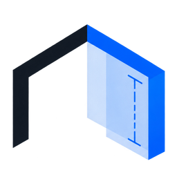
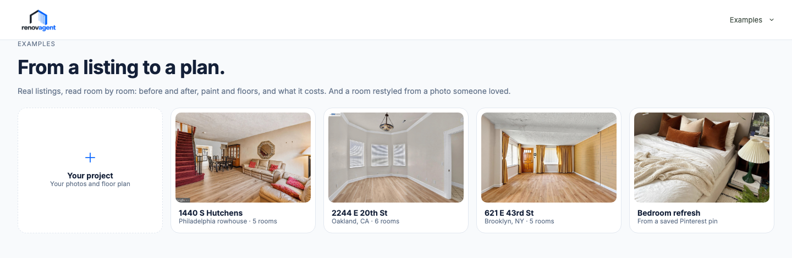
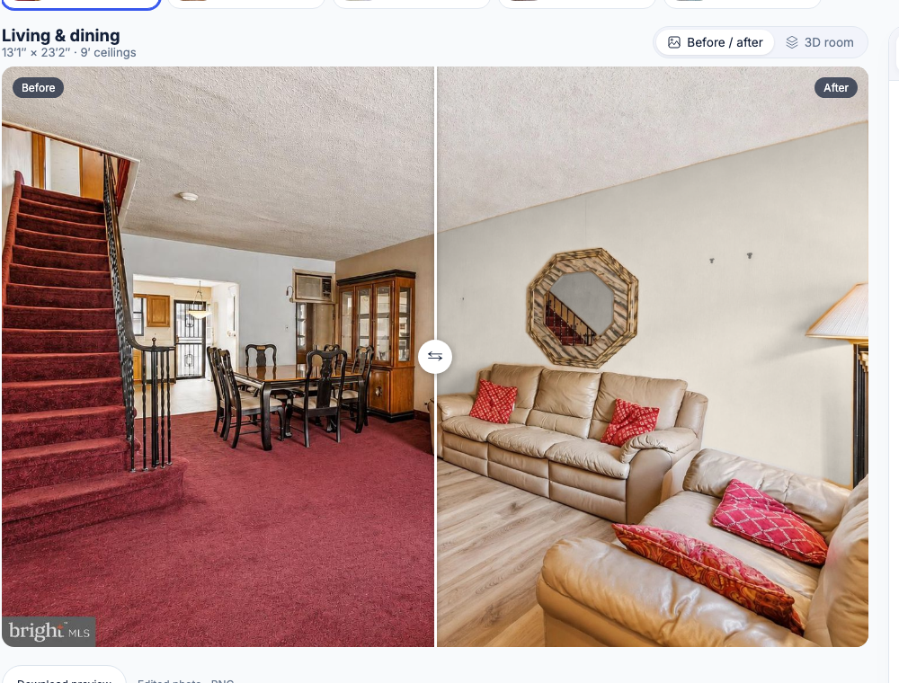
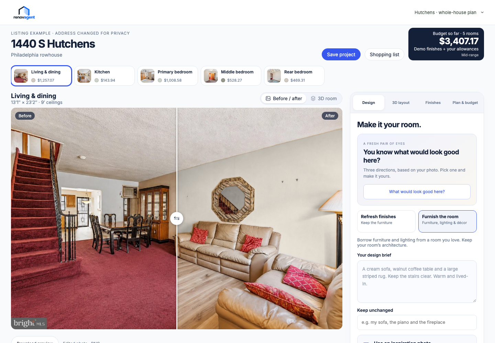
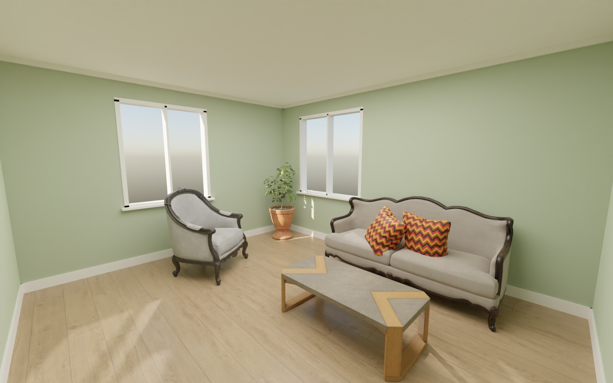
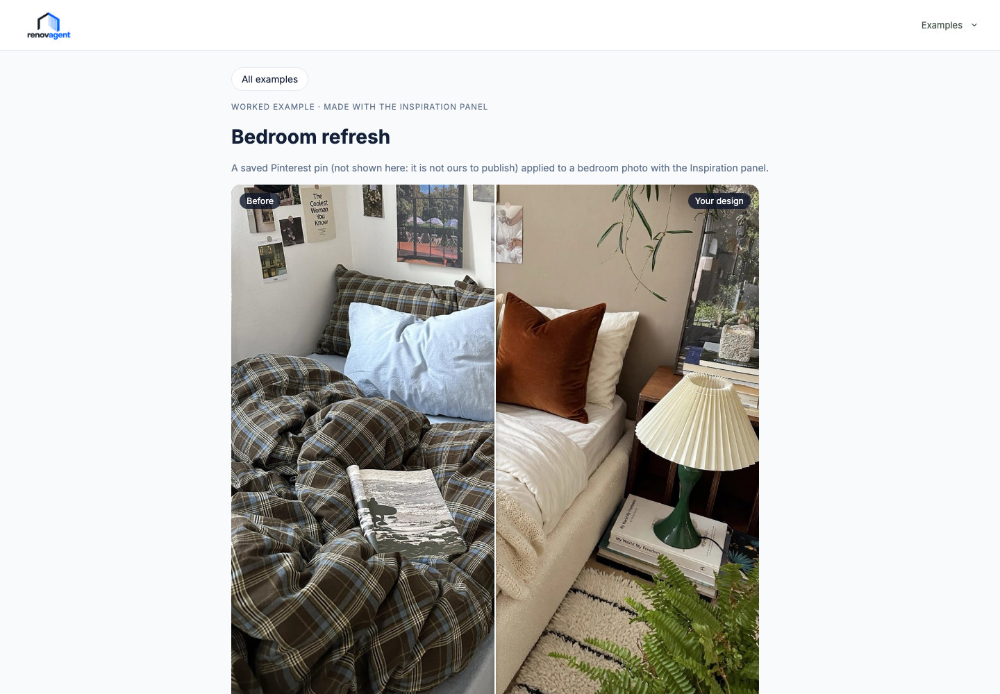
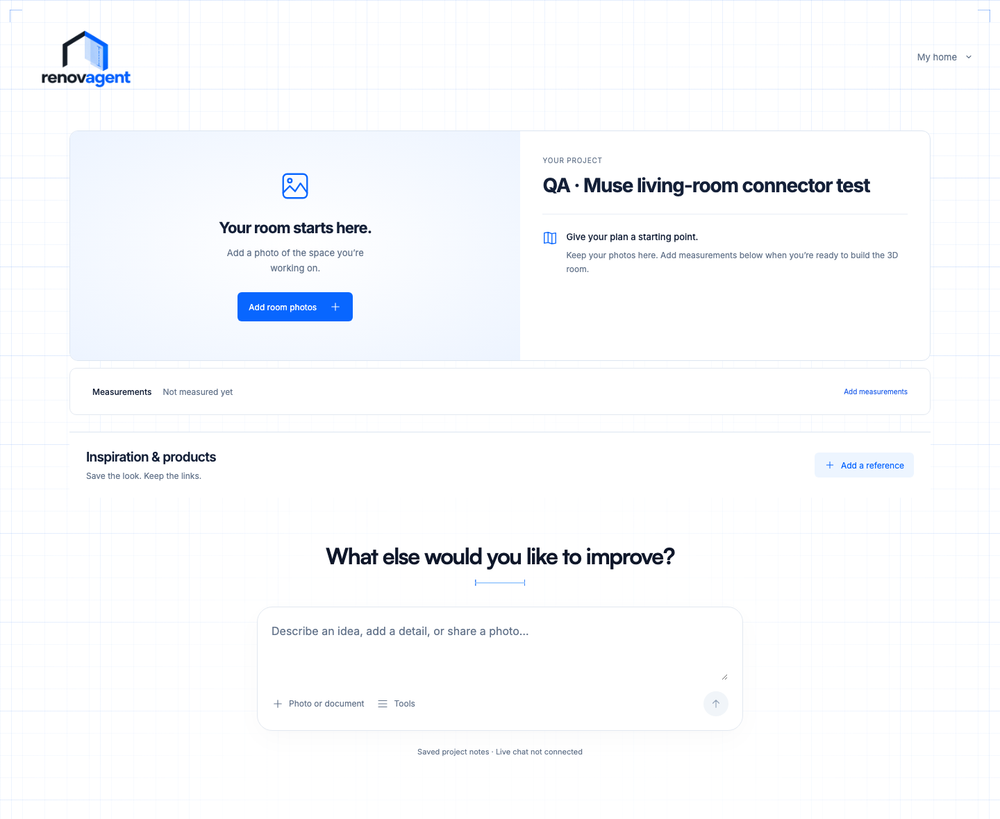

# RenovAgent

### See the possibilities. Plan the renovation. Bring your AI agent.

**RenovAgent is an AI-powered renovation studio that transforms real room photos into visual designs, 3D mockups, and persistent renovation projects.**

Built for the **Meta Global AI Developer Hackathon**, RenovAgent combines Meta's SAM 3.1, Muse Spark, and Muse Image with an interactive design studio and an agent-accessible project workspace.

**[Launch RenovAgent](https://renovagent-production.up.railway.app)** · [Architecture](docs/architecture/README.md) · [Development status](PROGRESS.md)



## What you can do

### 1. Select real surfaces with SAM 3.1

Upload a room photograph and identify walls and other design elements with Meta's Segment Anything technology. Experiment with paint colors on the actual room instead of a generic template.

- SAM 3.1-powered wall segmentation and masks
- Interactive paint selection and previews
- Segmentation of inspiration-image elements



### 2. Reimagine your room with Muse Image

Explore new flooring and room styles using AI-generated visualizations grounded in your original photo. Apply inspiration from another room while aiming to preserve the layout and recognizable features of your own space.

- AI-generated flooring variations
- Inspiration-guided room restyling
- Before-and-after comparisons
- Suggested paints and related material searches

*Generated visualizations illustrate design possibilities; they are not measured construction documents.*



### 3. Explore interactive 3D room mockups

Move beyond a flat photograph with an interactive 3D room representation. Explore layout and furniture possibilities, and produce rendered views of the modeled space.

- Interactive 3D room scenes
- Furniture and layout exploration
- Photorealistic render options
- Blender-based high-quality rendering workflow

**AR placement is a future direction**, not a verified feature of the current public demo.



### 4. Turn inspiration into design choices

Upload a reference image you like. RenovAgent analyzes its visual elements, identifies relevant colors and items, suggests nearby paint matches, and helps translate that style into your room.

- Muse Spark analyzes the inspiration and room context
- SAM 3.1 identifies visual elements
- Paint suggestions use color-distance matching
- Shopping suggestions link to store searches, not unverified inventory
- Muse Image can generate an inspiration-guided restyle



### 5. Save, share, and collaborate with an AI agent

RenovAgent is designed around a **persistent renovation project**, not a disposable chat session.

Create a personal workspace, retain your uploaded room photos, and let an external AI agent work with the same project through an authenticated MCP connection.

- Guest access and optional Google sign-in
- Owner-scoped project data and uploaded photos
- Agent-generated plans and shareable plan links
- Inspiration links and photos contributed through MCP
- Saved project briefs, evidence, drafts, and design decisions

**Current sharing scope:** agent-to-owner plan links and project collaboration through authenticated tools. Public project galleries and unrestricted collaborative editing are not claimed as shipped.



## How Meta AI powers RenovAgent

| Technology | Role |
| --- | --- |
| **SAM 3.1** | Segments walls and identifies elements in room and inspiration images |
| **Muse Spark** | Analyzes rooms, interprets design instructions, and translates inspiration into structured choices |
| **Muse Image** | Generates flooring edits, inspiration-guided restyles, and photorealistic room imagery |
| **Model Context Protocol (MCP)** | Connects external AI agents to persistent renovation projects and bounded proposal tools |

Supporting technologies include React, TypeScript, Three.js, MongoDB, and Blender. The hosted application runs on Railway.

## From a photo to a project

```text
Real room photos + inspiration
              |
     SAM 3.1 + Muse Spark
              |
    Surface and design choices
              |
       Muse Image edits
              |
   Interactive 3D mockups
              |
   Persistent project record
              |
   Owner + connected AI agent
              |
   Plans, references and handoff
```

The visual studio helps you explore what a space could become. The project workspace is intended to carry those ideas toward practical renovation decisions.

## Try it

**[Open the live demo](https://renovagent-production.up.railway.app)**

You can explore prepared listing examples or start with your own room photos. The hosted experience includes guest access and a connection flow for compatible MCP clients.

**Explore the examples** (no sign-in): [all examples](https://renovagent-production.up.railway.app/#examples) · [Philadelphia rowhouse](https://renovagent-production.up.railway.app/#example-house) · [Oakland](https://renovagent-production.up.railway.app/#example/oakland) · [Brooklyn](https://renovagent-production.up.railway.app/#example/brooklyn) · [bedroom refresh](https://renovagent-production.up.railway.app/#example/bedroom-refresh)

For agent connections, use the application's **Connect** flow to create a scoped access key. The MCP endpoint is:

```text
https://renovagent-production.up.railway.app/mcp
```

Do not put access keys in repository files or public screenshots.

## Run locally

Requires Node.js and npm.

```bash
npm install
npm run dev
```

Open the local app at `http://127.0.0.1:8741/`.

The default local workspace uses browser storage. To run the connected API, database, and MCP services:

```bash
npm run dev:connected
```

See the [connected setup guide](docs/architecture/connected-muse-and-mongo.md) for environment configuration, database selection, credentials, and limitations.

## Development and testing

| Command | Purpose |
| --- | --- |
| `npm test` | Run contract, domain, legacy, and integration tests |
| `npm run test:connected` | Run connected integration tests against local MongoDB |
| `npm run build` | Type-check, validate boundaries, and build |
| `npm run build:pages` | Produce a static GitHub Pages package |

### Repository structure

- `apps/web/` — web application and design studio
- `apps/api/` — connected API, model calls, and MCP services
- `packages/contracts/` — shared schemas and commands
- `packages/core/` — planning logic and domain rules
- `tests/` — automated verification
- `docs/architecture/` — architecture and implementation notes

## Project status and roadmap

RenovAgent is an active prototype. Its visual studio, selected 3D rendering workflows, project persistence, and MCP integrations are implemented, with functionality varying by environment and configuration.

**Planned or incomplete capabilities** include camera-based AR placement, broader sharing and collaboration, verified live supplier prices, contractor verification, purchasing, and billing.

Example material prices are illustrative rather than live offers. AI-generated designs are conceptual; physical dimensions, material suitability, code requirements, and contractor decisions require separate verification.

For detailed implementation status and limitations, see [PROGRESS.md](PROGRESS.md) and [HANDOFF.md](HANDOFF.md).

---

**RenovAgent — from the room you have to the home you imagine.**
