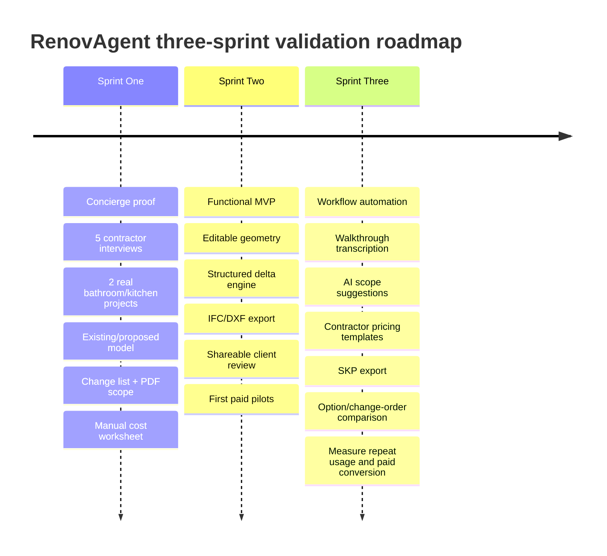

# RenovAgent Commercial Landscape and Customer-Pain Research

## Executive summary

RenovAgent is entering a **crowded but still fragmented** market. The current stack is split across capture/documentation tools such as CompanyCam and Matterport; measurement/modeling tools such as HOVER, magicplan and RoomPlan-based products; design/rendering tools such as SketchUp, Cedreo, Coohom and Planner 5D; and estimating/project-management tools such as Handoff, Houzz Pro, JobTread and Buildertrend. Several products now bridge two of those categories, but few cleanly carry a residential renovation through **existing conditions → proposed structured model → scope/change list → preliminary cost → open 3D/CAD handoff**. citeturn923445search5turn822871search0turn940668search1turn940668search4

The important correction to the earlier product thesis is that **“walk around with your phone and AI writes an estimate” is no longer enough**. Handoff already advertises AI site walkthroughs, voice-to-estimate, scopes, materials lists and renderings; CompanyCam converts walkthrough recordings into organized notes, tasks and reports; Houzz Pro can turn a 3D floor plan into an AI-assisted estimate; and magicplan links measured floor plans, scope items, quantities and estimates. citeturn940668search1turn923445search5turn940668search4turn822871search0

The stronger opportunity is **renovation intent as structured data**:

> **Capture the house as it exists → edit what will change → automatically describe those changes in human, estimating and CAD terms → hand the result to whoever builds it.**

That is materially different from “AI interior design.” The proposed-state model is not merely a visualization; it is the common representation from which client approval, scope, estimate and downstream SketchUp/CAD work are derived.

There is credible demand for the underlying problems. Houzz's 2025 homeowner survey found that 48% of respondents struggled to find a professional they trusted, 34% struggled to get clear detailed estimates/proposals, 41% said clearer timelines would have improved the renovation experience and 40% wanted better communication. In Houzz's 2026 renovation study, 37% of renovators exceeded their original budget; higher-than-expected product/service costs, greater project complexity and scope/design changes were major reasons. citeturn166615search3turn166615search0

The strongest **initial commercial customer is the small design-build remodeler / kitchen-and-bath contractor**, not the homeowner. Contractors repeatedly complain about unpaid estimating time, translating messy walkthrough notes into polished bids, clients who have not adequately defined scope, and repeated revisions. Recent public threads include remodelers saying estimates are slow enough that competing quotes reach customers first, contractors spending disproportionate time preparing bids they may never win, and GCs struggling to compare bids because the homeowner has not produced a defined scope. citeturn606300reddit30turn606300search13turn606300reddit37

The **consumer opportunity is real but episodic**. Homeowners want early cost visibility, apples-to-apples proposals, confidence about what the finished result will be, and less ambiguity over changes. But they renovate infrequently, which makes recurring SaaS difficult unless the homeowner is acquired through a contractor, inspector, agent, lender or marketplace. citeturn730726reddit49turn730726reddit44turn166615search4

The **inspection-to-action opportunity is also strong**, but it has a liability and positioning trap. Spectora's ecosystem now includes built-in cost ranges, repair-request tools and Repair Pricer integration; inspectors themselves openly debate whether repair estimates expose them to unnecessary liability or produce misleading numbers because hidden conditions and regional pricing can radically change costs. citeturn526174search4turn526174search0turn449629search4 RenovAgent should therefore say **“preliminary planning range / contractor-ready scope”**, not “accurate contractor quote,” unless a contractor has verified it.

The Meta hackathon is unusually relevant. Three winning projects demonstrate that much of the proposed technical pipeline is now achievable quickly: **David Barry's Basement Ready** converts ordinary phone video into a measured 3D basement representation, checks building-code issues, gives rough costs, visualizes layouts and creates a draft permit set; **Consai/Punchwalk** turns a video construction walkthrough into verified defects and trade-specific actions; and **Video2URDF** turns phone video into measured structured geometry and validates the resulting model against the source video. citeturn286421search4turn923445search1turn923445search0 Formwright adds another useful pattern: let AI reason about a design, but make deterministic software validate geometry and constraints before claiming completion. citeturn923445search2

That means RenovAgent's moat cannot be **“AI can look at a video.”** The moat, if one emerges, is likely to come from workflow, renovation-specific change semantics, a contractor's reusable estimating knowledge, interoperability, and accumulated project data.

My recommended wedge is:

**“Visual renovation proposal for remodelers: scan/import existing space, show the client proposed changes in 3D, and generate the editable scope and preliminary budget from the same model.”**

Do **bathrooms and kitchens first**. Keep furniture/decor optional. Concentrate on walls, openings, cabinets, fixtures, plumbing/electrical relocations, finishes and dimensions—the things that alter work and money.

## Market and competitor landscape

The market is more advanced than a typical early-stage “AI for construction” opportunity. Several incumbents already own pieces RenovAgent might otherwise spend months recreating.

| Product | Core workflow | Current pricing/business model | Primary customer | Relevant strengths | Gap/opportunity for RenovAgent |
|---|---|---|---|---|---|
| **Handoff** | AI estimating, voice transcription, site walkthroughs, scope, materials, proposals, project management, AI renderings | Flex $119/mo annual; Pro $239/mo annual; Scale $719/mo annual | Residential contractors/remodelers | Extremely close to walkthrough→estimate; localized pricing; contractor-centric | Product is estimate/business-management led. RenovAgent could compete around **structured editable existing/proposed geometry and open CAD handoff**, rather than another estimator. citeturn940668search1turn940668search6 |
| **Houzz Pro** | 3D floor plans, estimating, takeoffs, selections, client portal, PM | Free tier; Pro $199/mo; Teams $399/mo+ | Remodelers/designers/builders | Already converts 3D plans into AI-assisted estimates; excellent client-facing workflow | Creates serious competitive pressure. Opportunity must be faster capture/editing, stronger construction-change semantics, and/or better open export/interoperability. citeturn940668search0turn940668search4 |
| **magicplan** | Mobile measurement, LiDAR/manual floor plans, photos, scope, quantities, estimates | Project-based pricing; all functions bundled in current plans | Restoration, contractors, field teams | DXF, IFC, OBJ, USDZ and spreadsheet exports; scope quantities linked to plans | Very close to the proposed data architecture. RenovAgent must make **proposed renovation editing + AI reasoning + client visualization** dramatically easier. citeturn822871search0turn822871search1 |
| **HOVER** | Phone capture → measured interior/exterior 3D model → design/estimate | Pay/project; Pro $999/yr; Business $2,999/yr plus project fees | Roof/exterior/interior contractors | Strong measurement pipeline; exports SKP, DWG, DXF and other formats | Validates willingness to pay for measured geometry. RenovAgent could specialize in **interior renovation state changes**, rather than measurement alone. citeturn822871search5turn822871search6 |
| **CompanyCam** | Jobsite photo/video documentation, AI walkthrough notes, tasks, reports | Core $79/mo; Crew $149/mo; Scale $299/mo | Contractors/field crews | Excellent low-friction capture and project history | It captures “what was said/seen,” but not a full proposed-state renovation model and CAD handoff. citeturn923445search5turn923445search6 |
| **Spectora + Repair Pricer** | Inspection report → findings → repair requests / preliminary cost | Spectora $109/mo; Repair Pricer consumer reports about $80–$110; inspector wholesale lower | Inspectors, buyers, agents | Strong post-inspection workflow; already addresses “what will repairs cost?” | RenovAgent should avoid being merely another repair-pricing layer; opportunity is turning findings into **visual/project scope and proposed renovation geometry**. citeturn923445search7turn526174search0turn526174search5 |
| **Matterport** | 3D property capture/digital twin; purchasable floorplan/CAD/BIM outputs | Subscription + paid deliverables; e.g. schematic plans and MatterPak/E57/CAD/BIM services | Real estate, facilities, AEC | Established capture and downstream technical-file ecosystem | Existing-state capture is commoditizing; RenovAgent could treat Matterport as an **input**, not rebuild it. citeturn822871search7turn822871search8 |
| **SketchUp** | Freeform professional 3D modeling + documentation | Pro $33.25/user/mo annual; Studio $71.58 | Designers, architects, builders, renderers | Extremely familiar output format; strong plugin ecosystem; IFC/DWG workflow | Manual modeling remains expertise-heavy. A RenovAgent model that arrives cleanly in SketchUp is valuable even if RenovAgent never replaces SketchUp. citeturn671098search0turn346751search6 |
| **Chief Architect** | Residential BIM-ish design, construction docs, materials lists, rendering | $1,995/yr or $229/mo | Residential designers/builders | Deep residential construction intelligence; plans, framing, sections, materials | Powerful but expensive and expert-oriented. RenovAgent opportunity: make **early preconstruction design/communication** much faster, then export downstream. citeturn671098search1turn671098search8 |
| **Cedreo** | Fast residential floor plans, layouts and renderings | Professional positioning from about $129/mo | Home builders/remodelers/designers | Designed explicitly for sales presentations and rapid 3D | Strong visualization competitor; less focused on capturing real existing conditions and propagating deltas into field scope. citeturn822871search12turn822871search13 |
| **Coohom** | Interior design, huge catalog, renders, walkthroughs, BOM, CAD drawings | Pro ~$25/mo annual; Elite ~$58/seat/mo annual | Interior designers/studios | Extremely cheap high-quality visualization; CAD construction drawings at higher tier | Evidence that **rendering itself is becoming cheap**. Competing on visual prettiness alone is unattractive. citeturn671098search3turn671098search5 |
| **Planner 5D** | Consumer/pro 2D/3D planning, AI floor-plan recognition, renders, CAD export | Premium $59.99/yr; Professional $399.99/yr | Homeowners/designers | Very low-cost visualization and CAD export | Further commoditizes “make my room look nice.” RenovAgent must tie visualization to **actual renovation work and costs**. citeturn671098search2 |

The competitive implication is important: **RenovAgent should not try to win on generic rendering, generic floor planning, generic photo documentation or generic estimating.** Those markets have well-funded incumbents with mature workflows and low prices. citeturn671098search2turn671098search3turn923445search6turn940668search1

The promising seam lies between those systems.

A remodeler currently may document a house in CompanyCam, measure it in magicplan or HOVER, model the design in SketchUp/Cedreo/Chief Architect, quote it in Handoff/Houzz/JobTread, then communicate changes through PDFs, texts and meetings. Each tool is individually capable; the friction is the **translation between representations**. That is an inference from the product boundaries above and the user complaints below. citeturn923445search5turn822871search1turn940668search1turn671098search8

### Hackathon signals

The Meta winners should materially influence the product strategy.

**David Barry / Basement Ready is the closest conceptual warning.** Its hackathon demo takes a phone video of a basement, derives measured 3D geometry without requiring LiDAR, identifies building elements, checks Ontario code constraints, estimates rough cost, visualizes layouts and prepares a draft permit set. That is astonishingly close to one vertical slice of RenovAgent. citeturn286421search4

**Consai/Punchwalk proves the value of video plus narrated intent.** A 105-second site walk in its demonstration becomes structured defects with room, trade, severity, evidence and suggested fix. Crucially, it links each item back to visual evidence rather than letting an LLM freely hallucinate. citeturn923445search1

**Video2URDF demonstrates a second principle RenovAgent should copy:** derive structured geometry from video, then validate the derived structure against the original visual source and explicitly distinguish measured from estimated information. citeturn923445search0

**Formwright demonstrates the third:** AI can orchestrate design decisions, but geometry/engineering constraints should be checked deterministically rather than trusted because a generated image “looks right.” citeturn923445search2

That suggests a RenovAgent architecture with three layers:

1. **Perception:** what exists?
2. **Intent:** what does the user want changed?
3. **Verification:** does the structured model actually reflect the measurements and proposed changes?

The rendering engine then becomes a presentation of that structure—not the source of truth.

## Voice of the customer: what people are actually complaining about

I reviewed public Reddit threads across contractor, homeowner, estimating, real-estate-adjacent and design communities, plus public InterNACHI inspector discussions and software-review aggregators. Closed contractor Facebook groups are generally not crawlable or reliably verifiable from the public web, so I am **not** claiming direct access to private Facebook-group conversations; the conclusions below rely on public original threads and visible review sources.

### Walkthrough-to-estimate pain

The contractor complaint is remarkably consistent: **the site visit is not the expensive part; converting the site visit into a defensible proposal is.**

A kitchen-and-bath remodeler described taking notes during the walkthrough, then rebuilding the estimate in a spreadsheet later; by the following morning competitors had already sent bids. Another contractor described spending 30–45 minutes producing a quote for work that might itself take only two hours. A long-running GC's office manager said timely estimates had become increasingly difficult and asked whether software or an outsourced service could take over the process. citeturn606300reddit30turn606300reddit29turn606300reddit35

This is exactly why Handoff markets voice transcription, AI site walkthroughs and same-day estimate generation, and why CompanyCam built AI walkthrough notes. citeturn940668search1turn923445search5

But contractors also complain about **accuracy and trust**. A July 2026 construction-software discussion described estimates requiring repeated corrections and highlighted common causes such as stale material prices, missing assembly components and guessed quantities. citeturn606300reddit31 This suggests that RenovAgent should treat AI as a *first draft* and expose quantities, assumptions and source geometry rather than hide them behind a confident dollar total.

### Scope definition and apples-to-apples bidding

A residential GC described a persistent problem on $50,000+ jobs: homeowners approach multiple contractors with only a vague idea of what they want, so each contractor prices a different implied scope and the resulting quotes cannot be compared meaningfully. citeturn606300reddit37

Homeowners report the mirror image. One recent poster received labor-only pricing and was told a materials list would not be produced until after signing and paying a deposit; another complained about getting a $10,000 “guesstimate” over text without meaningful discussion of specifications or materials. citeturn730726reddit41turn730726reddit43

Houzz's survey evidence is stronger than anecdotes: 34% of homeowners in its renovation-experience sample said getting a clear, detailed estimate or proposal was a major struggle. citeturn166615search3

This is arguably RenovAgent's most valuable job:

> **Before three contractors bid, make one explicit visual scope everyone is bidding against.**

The homeowner can point at a proposed model and say, “this wall goes; this tub becomes a shower; the vanity moves here; this flooring remains; these cabinets are replaced.” The scope and dimensional model become a shared artifact.

### Budget surprises and change propagation

Budget overruns are common enough to be a product-level problem. Houzz's 2026 study reports that 37% of renovating homeowners exceeded their planned budgets; 52% of over-budget renovators cited higher-than-expected product/service costs, 32% cited unexpected complexity and 31% cited changes in scope or design. citeturn166615search0

Forum examples show exactly what those statistics look like. One homeowner described a renovation roughly $20,000 over its original sub-$100,000 price due largely to changes and unrealistic allowances; another described a contractor demanding an additional $90,000 after an alleged underquote on a project that had already consumed more than $200,000. citeturn730726reddit45turn730726reddit46

A RenovAgent feature that says **“this design change alters these work items and these quantities”** is therefore more valuable than a standalone render.

For example:

`existing tub → proposed tiled shower`

should not merely update pixels. It should generate a delta such as:

`remove tub + cap/remove tub spout + shower valve + drain condition verification + waterproof enclosure + tile area + shower glass + possible plumbing relocation`

The contractor still supplies the final means, methods and pricing. RenovAgent makes the consequences explicit.

### Visualization is valuable—but the pain is revision and fidelity

Visualization is not useless decoration. Houzz respondents explicitly said 3D rendering and clearer visualization of cabinet/layout decisions could have prevented problems, and 44% of couples in another Houzz renovation survey said they used visualization tools to resolve decisions. citeturn166615search4turn166615search6

A recent GC thread is even more direct: a residential design-build contractor said the missing part of an otherwise established preconstruction process was helping clients “see the bigger picture” with 3D renderings. Respondents said clients were impressed by SketchUp+AI workflows, but others called outsourced renderings expensive or unnecessary. citeturn402755reddit42

Render specialists, meanwhile, complain about the *cost of revisions*. A residential designer described clients continuously changing decisions while renders were being updated, repeatedly forcing work to restart; another architect described feedback arriving through Zoom, email and meetings, followed by months of revision cycles. citeturn402755reddit36turn402755reddit43

The economics can be nontrivial. In a 2026 SketchUp discussion, a kitchen designer described spending six hours on one multi-room model; an archviz thread described $400-per-room pricing with additional paid revision rounds, while another animation discussion described rendering cost as only one component of a much larger client price. These are anecdotes rather than market averages, but they demonstrate that editable upstream geometry has monetary value. citeturn402755reddit41turn402755reddit44turn402755reddit39

Therefore the interesting product is not:

**“AI makes a prettier bathroom image.”**

It is:

**“The client changes the vanity location once; the model, visuals, scope and downstream file all change together.”**

### Inspection-to-action pain

Post-inspection buyers face a particularly acute version of the scope/cost problem because decisions occur under transaction deadlines. Spectora's 2026 industry research reports that buyers struggle to prioritize repairs after receiving the report, and that agents frequently encounter buyers stuck on repair-cost questions. citeturn577765view0

Spectora has responded by adding cost-estimator ranges and repair-request tooling, while Repair Pricer sells inspection-report-to-cost conversion directly to consumers and through inspector integrations. citeturn526174search4turn526174search3turn526174search5

But inspectors themselves repeatedly warn that hidden conditions, local labor differences and liability make repair-cost predictions dangerous. A 2025 InterNACHI discussion contains both favorable experiences with Repair Pricer and strong objections from inspectors with contracting backgrounds who argue software estimates can be materially wrong. citeturn449629search4

That suggests an important boundary for RenovAgent:

**inspection finding → prioritized preliminary project scope → planning range → request verified contractor pricing**

is safer and more useful than

**inspection finding → definitive repair quote.**

## Customer segments, pain ranking and willingness to pay

The following ranking synthesizes the public complaint evidence, incumbent pricing and frequency of the workflow. “WTP” is therefore a **commercial inference**, not a measured RenovAgent pricing study.

| Segment | Ranked pains | What actually drives payment | Likely WTP | Commercial attractiveness |
|---|---|---|---|---|
| **Small remodelers / design-build contractors** | **1.** Unpaid estimating/admin time; **2.** vague homeowner scope; **3.** repeated client revisions; **4.** difficulty communicating proposed outcome; **5.** estimate errors / quantity uncertainty | Faster quote turnaround, better close rate, paid preconstruction, fewer misunderstandings/change disputes, reusable model for handoff | **High recurring**. Existing tools successfully charge roughly $100–$300+/mo, with higher tiers much above that. citeturn940668search1turn940668search0 | **#1 target** |
| **Homeowners undertaking material renovations** | **1.** Not knowing realistic total cost; **2.** unclear/incomparable bids; **3.** inability to visualize outcome; **4.** scope creep/change surprises; **5.** finding trustworthy pros | Confidence before committing $10k–$100k+, contractor-comparison package, understandable project brief, visual approval | **Medium per-project**, probably poor standalone subscription economics. Houzz reports median renovation spend of $20k in 2025 and 31% of projects at $50k+. citeturn166615search0 | **Strong secondary / channel customer** |
| **Real-estate investors / flippers / landlords** | **1.** Fast feasibility before purchase; **2.** rehab budget uncertainty; **3.** repeatable scopes; **4.** contractor bid normalization; **5.** remote documentation | Faster go/no-go decision, conservative rehab budget, shareable scope across multiple bids, repeat use | **Medium-high**, especially per property or portfolio | **#2 or #3 target** |
| **Inspectors / agents / recent buyers** | **1.** turning defects into priorities; **2.** “what will this cost?”; **3.** identifying appropriate trade; **4.** transaction deadline; **5.** turning report into action after closing | Add-on revenue, differentiated inspection service, smoother negotiations, post-close homeowner engagement | **Medium**; Repair Pricer establishes consumer prices around $80–$110/report and inspector wholesale around $25–$48/report. citeturn526174search0turn526174search5 | **Good channel, but liability-sensitive** |
| **Render / interior-design specialists** | **1.** manual model creation; **2.** revisions; **3.** client feedback fragmentation; **4.** converting source data between formats; **5.** clients expecting cheap renders | Clean existing-condition model, rapid option generation, structured revision history, reliable export into existing tools | **Medium**, but highly price-competitive because rendering tools are inexpensive and outsourcing is global. citeturn671098search3turn402755reddit44 | **Enable them; don't lead with them** |

The contractor segment wins because the pain recurs every week and is directly connected to revenue. A \$150/month tool is easy to justify if it saves even a few estimating hours, helps win one additional remodel, or converts unpaid design work into a paid preconstruction deliverable. Existing contractor software pricing indicates that this customer already tolerates meaningful monthly SaaS spend when the value is clear. citeturn923445search6turn940668search1turn940668search0

The homeowner is compelling as a **user**, but less attractive as a direct SaaS buyer because renovation is episodic. A contractor-facing product can give every customer access to the model without requiring each homeowner to independently discover and purchase RenovAgent.

The render specialist is strategically useful because **open exports create distribution**. If RenovAgent produces a clean `.skp`, IFC/DXF or equivalent file, a professional can continue in SketchUp, Chief Architect, AutoCAD, Blender or another preferred environment instead of being forced to recreate the model.

## Technical feasibility of an existing → proposed → scope/cost MVP

Technically, this is feasible today. The hard part is not rendering; it is maintaining **structural consistency** between capture, proposed edits, quantities and export.

Apple RoomPlan already produces a parametric representation of walls, doors, windows, openings and recognized objects, including dimensions and transforms, and can combine multiple rooms into a captured structure. It exports USD/USDZ and exposes structured results that an application can modify. citeturn346751search0turn346751search1turn346751search2

SketchUp's SDK can read and write native `.skp` files from standalone applications. IFC is an open standardized representation for built assets, while DXF/DWG remain common CAD interchange formats. citeturn346751search6turn346751search11turn346751search9

You therefore do **not** need to solve universal photogrammetry from scratch.

### Recommended MVP architecture

| Layer | MVP implementation | Effort estimate | Main risk |
|---|---|---:|---|
| Existing-space capture | Import RoomPlan/USDZ or manual 2D measurements; optional photo/video attachment | 1–2 engineer-weeks | Cross-device capture quality |
| RenovAgent canonical model | JSON/DB representation of rooms, walls, openings, fixtures, cabinetry and finishes with stable IDs | ~1 week | Bad schema causes endless downstream pain |
| Existing/proposed states | Clone baseline → edit/remove/add objects; maintain change/delta object | 2–3 weeks | Complex geometry editing UX |
| Visualizer | WebGL/Three.js-style viewer or native rendering over structured model | 1–2 weeks | Making editing intuitive, not rendering itself |
| Scope generator | Rules + LLM convert model deltas into editable work items; every scope item links to affected geometry | 2 weeks | Hallucinated construction implications |
| Cost worksheet | Quantity extraction + user-defined/local placeholder rates + confidence/assumption flags | 1–2 weeks | False precision |
| Export | IFC/OBJ/DXF first; `.skp` via SketchUp SDK after workflow validation | 1–2 weeks | SDK/licensing/integration edge cases |
| QA / correction | Dimension editing, confidence flags, before/after overlay, export validation | 1–2 weeks | Users will tolerate imperfect capture only if correction is easy |

**My estimate:** one strong full-stack/3D engineer could produce a deliberately narrow bathroom/kitchen proof-of-concept in roughly **8–12 focused weeks**; a two- or three-person team could plausibly reach a field-testable version in **4–7 weeks**. That estimate assumes existing rendering/capture libraries rather than inventing computer vision infrastructure.

The product model should look conceptually like this:

```text
Project
 ├── ExistingState
 │    ├── Room
 │    ├── Wall
 │    ├── Opening
 │    ├── Fixture
 │    └── Finish
 │
 ├── ProposedState
 │    └── same stable object taxonomy
 │
 └── Changes[]
      ├── REMOVE bathtub-12
      ├── ADD shower-31
      ├── MOVE vanity-4
      └── CHANGE finish-wall-8

Changes
   ↓
Scope rules
   ↓
Quantities / assumptions
   ↓
Cost worksheet
   ↓
PDF + IFC/DXF/SKP
```

The crucial engineering decision is **stable semantic IDs and deltas**. If the user moves a vanity, the system should know that *vanity-4 moved 42 inches*, not merely that the rendered image changed. That delta can then drive scope suggestions and exports.

### What not to build in the MVP

Do not spend the first MVP on massive furniture catalogs, generative decor, photorealistic staging, landscape design, permit automation for every jurisdiction, full BIM authoring, structural engineering or highly precise contractor pricing.

Coohom and Planner 5D already make styling/rendering extraordinarily cheap. Chief Architect and SketchUp already provide sophisticated professional modeling. Handoff and Houzz already invest heavily in estimating. citeturn671098search2turn671098search3turn671098search8turn940668search1

The minimal technical proof should instead demonstrate one thing incumbents do not present as elegantly:

> **“Move this thing in the proposed model and see exactly what changed, what work that implies, and what file I can give my contractor/designer.”**

For an initial bathroom example, the system only needs perhaps 20–30 semantic construction objects: wall, door, window, tub, shower, toilet, vanity, sink, cabinet, light, outlet, switch, plumbing fixture, floor finish, wall finish, ceiling, niche, fan and a handful of generic built-ins.

## Validation experiments

The biggest mistake would be spending two months perfecting the 3D engine before determining **which party cares enough about the output to pay**. These experiments deliberately separate market validation from engineering.

| Experiment | Cost/effort | What you do | Success criterion |
|---|---:|---|---|
| **Concierge remodel proposal** | 1–2 days/project | Recruit 5 remodelers. Take one of their real walkthroughs and manually produce an existing/proposed 3D model + visual scope + cost worksheet. | ≥3/5 say they would use it on another live lead; ≥2 give you the next project without being chased. |
| **Paid preconstruction pilot** | Very low | Offer contractors “client-ready visual scope in 24 hours” at **$49 / $99 / $199 per project** in three sequential tests. | At least 3 paid jobs; strongest signal is a contractor passing cost to the homeowner rather than negotiating it away. |
| **Scope-before-bid homeowner test** | Manual | Give 5 homeowners with active $10k+ projects a standardized existing→proposed scope they can send to contractors. | ≥3 actually send the package to multiple bidders; ≥2 report that it materially clarified bids or conversation. |
| **Export-value test** | 1 week | Produce the exact same sample model as `.skp`/IFC/DXF and send it to 10 designers/renderers/contractors. | ≥5 can open/use it without remodeling from scratch; ≥3 say reusable geometry changes their willingness to adopt/pay. |
| **Landing-page + interview funnel** | <$500 | Run two pages: **“Walkthrough → estimate”** versus **“Existing → proposed 3D renovation plan + scope.”** Use small search/social spend and direct outreach. | Treat ≥8–10% qualified visitor→lead or ≥20% outbound response as promising; more importantly, measure which proposition produces actual project uploads/demo bookings. |

These thresholds are validation heuristics, not industry benchmarks.

### Contractor interview script

> I'm testing a tool for remodelers, not trying to sell you software on this call. I'd like you to walk me through the last job you estimated.
>
> After you left the customer's house, what work still had to happen before you could send a proposal?
>
> Which part took the most time?
>
> What information were you missing from the homeowner?
>
> How often does the homeowner change the design after you've priced it?
>
> Do you create a 3D model or render today? If not, why not?
>
> If you do, what does it cost you in employee time or outsourcing?
>
> If I gave you an editable existing/proposed model, an automatically generated scope, and a preliminary worksheet after the walkthrough, what would you still have to do manually?
>
> Show me the last proposal you actually sent. Where would this output need to fit?
>
> Would you use this on your next live lead? If yes, I'll do that project manually and you can tell me afterward whether it was worth paying for.

The key is **not** asking “Would you pay \$X?” first. Ask for a real project.

### Homeowner interview script

> Think about the moment before you hired your contractor. What were you least certain about?
>
> Did the contractors price exactly the same project, or were the scopes different?
>
> Was there anything you couldn't visualize until construction started?
>
> What changed after the initial quote?
>
> If you'd had a simple model showing your current room, the proposed room, every change and a preliminary cost range, what would you have done with it?
>
> Would you have sent it to contractors for bids?
>
> Would you have paid \$49, \$99 or \$199 for that package before committing tens of thousands of dollars to the renovation?
>
> What would it need to contain for you to trust it?

For both groups, avoid showing a polished demo until after they explain their current workflow. Otherwise they will politely react to your features instead of revealing actual pain.

## Product recommendation and three-sprint roadmap

The strongest commercial concept I see is **not** “AI renovation designer.”

It is:

### RenovAgent: visual preconstruction for residential remodeling

**Capture what exists. Agree on what changes. Know what that implies. Hand it off.**

That positioning connects four pains that already have demonstrated economic value: estimating time, scope definition, client visualization and revisions. citeturn606300reddit30turn606300reddit37turn166615search4turn402755reddit36

### Prioritized feature stack

**Tier A — prove immediately**

1. Existing-condition room import/capture.
2. Editable walls/openings/basic fixtures.
3. Existing ↔ proposed toggle.
4. Change/delta list generated directly from model edits.
5. Simple client share link.
6. Editable scope of work linked to changes.
7. PDF proposal package.
8. IFC/DXF/OBJ export, then SKP.
9. Basic quantity extraction.
10. Contractor-editable preliminary cost worksheet.

**Tier B — after people pay**

11. Narrated video walkthrough → proposed change suggestions.
12. Photo pins linked to model elements.
13. Contractor pricing libraries/assemblies.
14. Alternate options: “Option A / B / C.”
15. Change-order comparison after client revision.
16. Inspection-report ingestion.
17. AI render generated *from the structured proposed state*.

**Tier C — resist until strong PMF evidence**

18. Furniture shopping.
19. Giant decor catalog.
20. Generic “make it Scandinavian” image generation.
21. Full project-management suite.
22. Universal permitting.
23. Full BIM authoring.
24. Automatic definitive contractor quotes.

The last group is where you are most likely to repeat the pattern you identified earlier: *“It can be better”* turning into months of technically impressive work that does not test whether anybody wants the actual product.



### Sprint one: prove the job exists

Use your own past renovations as seed data, but put the output in front of **five working remodelers** as quickly as possible.

The goal is not a beautiful application. The goal is to determine whether the artifact itself matters.

A contractor should be able to show a homeowner:

**Existing**
→ ugly bathroom

**Proposed**
→ shower here, double vanity here, door moved

**Changes**
→ six explicit physical changes

**Scope**
→ demo/plumbing/electrical/tile/carpentry/finish work

**Budget**
→ contractor-adjustable planning ranges

If they say *“I need this on my next estimate,”* you have something.

### Sprint two: automate the common path

Build only enough modeling to reproduce those concierge outputs.

The first killer interaction could simply be:

**Click an element → Keep / Remove / Replace / Move**

Every action updates the change ledger.

That is much easier to understand commercially than a full CAD program.

Export matters surprisingly early because it prevents a common SaaS objection: **“What happens when I need a real professional?”** The answer becomes: *send them the model.*

HOVER already validates demand for SKP/DWG/DXF handoff, magicplan supports multiple open 2D/3D formats, and SketchUp explicitly supports programmatic `.skp` creation. citeturn822871search6turn822871search1turn346751search6

### Sprint three: make the walkthrough intelligent

Only after the underlying structured workflow works should the flashy AI arrive.

A contractor walks through:

> “We're removing this tub. The homeowner wants a shower. Vanity stays but we're replacing it. Tile all the way to the ceiling.”

RenovAgent maps those utterances to objects and suggested changes.

The model shows:

**Remove tub?**
**Add shower envelope?**
**Replace vanity?**
**Change wall finish to tile?**

The contractor confirms.

That interaction borrows the strongest ideas from Consai and Video2URDF: AI observes and proposes, but the system keeps **visual evidence and human verification** attached to each structured action. citeturn923445search1turn923445search0

## Bottom-line commercial assessment

I would score the opportunity this way:

| Dimension | Assessment | Why |
|---|---|---|
| Customer pain | **Strong** | Estimating, scope ambiguity, budget surprises and client visualization are repeatedly documented. citeturn166615search3turn606300reddit30turn606300reddit37 |
| Existing competition | **Very strong** | Houzz Pro, Handoff, magicplan and HOVER already cover major portions of the flow. citeturn940668search0turn940668search1turn822871search0turn822871search5 |
| Technical feasibility | **High** | Structured room capture, model export and AI walkthrough interpretation all have demonstrated implementations. citeturn346751search1turn346751search6turn923445search1 |
| Rendering as moat | **Low** | Cheap, capable rendering/design products are widespread. citeturn671098search2turn671098search3 |
| Structured renovation delta as moat | **Promising but unproven** | Existing products touch pieces of it; the opportunity is the integration and workflow rather than a novel primitive. |
| Contractor recurring revenue | **Strongest business model** | Contractors have frequent projects and established SaaS spending behavior. citeturn923445search6turn940668search1turn940668search0 |
| Direct homeowner SaaS | **Weak** | Pain is high but renovation frequency is low; per-project or contractor-mediated distribution is more natural. |
| Inspection add-on | **Interesting** | Clear demand exists, but repair-cost liability and accuracy require careful positioning. citeturn526174search0turn449629search4 |

The key strategic finding is therefore:

**Do keep the 3D. Don't build it as a rendering product.**

The 3D model is valuable because it gives everybody—the homeowner, contractor, estimator and renderer—the same concrete definition of **what exists and what is going to exist**.

The product should make this transition extraordinarily easy:

**video / scan / measurements**
→ **existing model**
→ **proposed edits**
→ **explicit changes**
→ **scope**
→ **preliminary cost**
→ **client approval**
→ **SketchUp/CAD handoff**

That is much more defensible than “upload a bathroom and get a pretty renovation image,” and it aligns much more closely with the complaints people are actually expressing in the market.