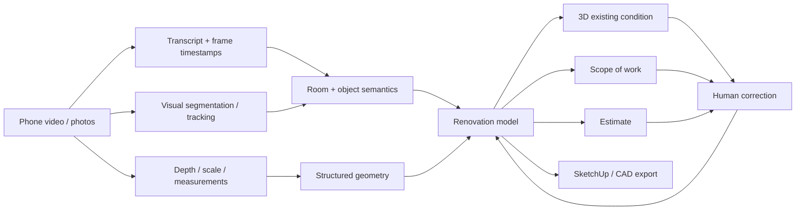

# What the Hackathon Results Mean for RenovAgent

## The most relevant winner is not Video2URDF — it is Consai/Punchwalk

The startup-track winner, **Consai**, submitted a product called **Punchwalk** that is strikingly close to one of RenovAgent’s strongest proposed workflows. Punchwalk lets an inspector or construction professional film a site walk with a phone or Meta glasses, narrate defects, and point to problems; the system then produces a structured punch list with the defect image, exact video timestamp, spoken description, proposed fix, trade, room, and severity. It also routes verified items to trades and can compare a later walkthrough against the original to determine whether work was actually fixed. citeturn770557search3

That matters because it is unusually strong evidence for the basic thesis:

> **Walkthrough video → transcript + visual grounding → structured construction information is both technically feasible and compelling enough to win a major AI competition.**

Punchwalk reports that, on its labeled test walks, it identified all 12 defects in the test set, assigned all 12 to the correct trade and room, caught two false “fixed” claims, and converted a 105-second walkthrough into a punch list in under five minutes at a reported inference cost of about $0.54. Those are developer-reported benchmark results rather than independent validation, but they provide a useful feasibility reference point. citeturn770557search3

The implication for RenovAgent is **not** “someone already built it, abandon the idea.” Punch lists are a relatively narrow construction-closeout workflow. RenovAgent can occupy a substantially broader and earlier part of the renovation lifecycle:

**existing condition → proposed renovation → scope → quantities/cost → visual model → contractor/customer communication.**

Punchwalk validates the *capture mechanism*. RenovAgent still needs to validate the *economic workflow*.

## Video2URDF strongly validates your 3D intuition

The indie fifth-place project **Video2URDF** is arguably the most technically relevant project to your “walk around something and derive structured 3D” ambition. It turns a short phone video of an articulated physical object into a measured URDF/MJCF model, using segmentation, tracking, depth/scale information, inferred geometry, and a validation loop that replays the reconstructed model against the source video. citeturn770557search0

Its architecture is especially interesting for RenovAgent because it does **not** merely ask a generative model to hallucinate geometry. The system separates semantic reasoning from deterministic measurement and validation: an agent identifies parts and invokes segmentation; code fits geometry and joints; then simulation is compared against the original footage, and the pipeline reports what was measured versus estimated. citeturn770557search0

That is almost exactly the engineering philosophy I would recommend for RenovAgent:

The lesson is important: **RenovAgent should use AI to interpret the scene, but structured geometry and construction rules should become deterministic data once inferred.**

That is much more defensible than “AI generates a pretty room.”

## Formwright provides the strongest product-design analogy

Startup runner-up **Formwright** may be an even better conceptual model for the product you are describing. Formwright takes a prompt describing a physical device and produces a schematic, PCB, enclosure, firmware, manufacturing checks, and pricing. Critically, the language model does not directly generate every engineering artifact unchecked: deterministic systems perform routing, design-rule checking, enclosure-fit verification, firmware checks, and other validations. citeturn770557search1

Its central pattern is:

**human intent → agent interprets → structured engineering model → deterministic checks → editable artifact → manufacturing/output.**

RenovAgent could eventually follow the analogous architecture:

**homeowner/contractor intent → agent interprets → structured renovation model → construction/cost checks → editable plan → contractor/CAD/export.**

That reinforces the distinction you were making earlier about 3D.

The commercial value isn't:

> “Look, AI made a nice kitchen.”

It's:

> “This is the kitchen we're proposing to build. Here is what changed, here are the associated work items, here is the estimated cost, and here is the model you can continue working with.”

That is much closer to an **AI-assisted preconstruction tool** than an interior-design generator.

## The hackathon actually makes the RenovAgent wedge clearer

The projects suggest several layers of the stack are becoming commoditized quickly.

**Capture and transcription are becoming cheap.** Punchwalk demonstrates timestamped narration tied to a walkthrough and visual evidence. citeturn770557search3

**Video-derived structured physical models are becoming feasible.** Video2URDF demonstrates segmentation, tracking, metric reconstruction and validation from ordinary video or phone depth information, albeit on much smaller articulated objects rather than rooms. citeturn770557search0

**Agents can orchestrate complex physical-design workflows when deterministic tools constrain them.** Formwright demonstrates this across electronics, enclosure geometry, firmware and pricing. citeturn770557search1

And **real-world visual interaction itself is becoming an agent interface**. Indie winner ControlAnything uses segmentation to identify physical objects and lets an agent generate interaction logic around them, showing the broader trend toward cameras becoming interfaces to structured agent workflows. citeturn770557search2

So I would not make RenovAgent’s moat “we transcribe renovation videos.”

That is rapidly becoming infrastructure.

Nor would I make it “we can identify a toilet and a vanity.”

That is also likely to commoditize.

The valuable layer is what happens **after perception**:

> **RenovAgent understands that the customer wants this room to become that room, converts the difference into structured construction work, attaches quantities and costs, and produces a model everyone can actually work from.**

That is a much stronger product thesis.

## Where I would now draw the product boundary

The hackathon evidence makes me more bullish on the three-part workflow we were circling, but I'd combine it more tightly.

| Layer | RenovAgent job | Existing evidence |
|---|---|---|
| **Capture** | Video, photographs, inspection PDFs, spoken walkthrough | Punchwalk strongly validates video + speech + visual grounding. citeturn770557search3 |
| **Understand** | Identify rooms, fixtures, defects, desired changes | Punchwalk and ControlAnything demonstrate grounded visual-semantic interpretation. citeturn770557search2turn770557search3 |
| **Model** | Create editable existing-condition geometry | Video2URDF demonstrates measurable structured reconstruction from video in another physical domain. citeturn770557search0 |
| **Propose** | User says “remove this tub, put shower here” | Formwright demonstrates natural-language intent driving structured physical design. citeturn770557search1 |
| **Reason** | Determine demolition, trades, materials, quantities, dependencies | This remains a core RenovAgent product/knowledge problem rather than something these winners fully solve. |
| **Price** | Translate scope into editable cost assumptions | This remains a commercial-data and estimating problem requiring validation against contractor workflows. |
| **Communicate** | Existing/proposed 3D + scope + estimate + PDF | RenovAgent can differentiate by keeping these views synchronized. |
| **Export** | SketchUp/CAD/structured project data | This would turn RenovAgent from a visualization toy into part of an existing professional workflow. |

That last part is particularly important.

A contractor or designer doesn't necessarily need RenovAgent to replace SketchUp, AutoCAD, Chief Architect, Revit, or their estimating system.

They may want RenovAgent to **eliminate the miserable first 60–80% of turning an unstructured walkthrough into something those tools can use.**

That is a much more achievable wedge.

## What I would steal from these winners

Not their features. Their **product architecture**.

From **Punchwalk**: every generated claim should preserve its evidence. If RenovAgent says “replace damaged drywall in bedroom,” the user should be able to jump directly to the photograph/video frame and narration that generated that item. citeturn770557search3

From **Video2URDF**: distinguish measured, inferred, and unknown information. A dimension derived from LiDAR is different from one estimated visually. RenovAgent should expose that distinction rather than pretending all geometry is equally certain. citeturn770557search0

From **Formwright**: don't let the LLM have the last word on engineering constraints. Use conventional code for dimensions, arithmetic, cost formulas, geometric operations, clearance checks and other deterministic rules; let the model orchestrate and explain them. citeturn770557search1

From **ControlAnything**: treat the physical environment as an interactive interface. Eventually a user could point at a wall and say “take this out,” rather than filling out a form describing Wall 3A. citeturn770557search2

The common design principle is remarkably consistent across the winners:

**AI interprets. Structured systems calculate. Humans correct. The product retains evidence.**

That is an excellent architecture for RenovAgent.

## Updated RenovAgent thesis

The hackathon results make me less interested in positioning RenovAgent as a collection of AI renovation features and more interested in one coherent object underneath everything:

### The renovation model

A RenovAgent project could contain:

**Existing condition**
- rooms
- walls/openings
- dimensions
- fixtures
- systems
- observed defects
- photographs/video evidence

**Proposed condition**
- additions/removals/moves
- changed dimensions
- selected fixtures/material classes
- layout alternatives

**Work graph**
- demolition
- framing
- plumbing
- electrical
- HVAC
- waterproofing
- finish work
- dependencies

**Commercial model**
- quantities
- material assumptions
- labor assumptions
- allowances
- cost range
- uncertainty

Everything else becomes a view of that model.

The 3D viewer is one view.

The estimate is another.

The scope is another.

The walkthrough slideshow your mother liked is another.

The SketchUp export is another.

The contractor PDF is another.

And that is why I now think your instinct that **3D isn't just decorative feature creep** is right.

If RenovAgent's 3D is merely photorealistic rendering, you're competing in a very crowded AI-design market.

If the 3D model is the **shared representation connecting what exists, what is changing, what has to be built, and what it costs**, it becomes central infrastructure for the product.

The Meta hackathon winners don't prove there is product-market fit for RenovAgent. They do, however, substantially strengthen the case that the underlying perception-and-agent technology is ready enough that **your scarce resource should go toward workflow, structured construction reasoning, exports, and customer validation—not proving that AI can understand a walkthrough.** citeturn770557search0turn770557search1turn770557search2turn770557search3