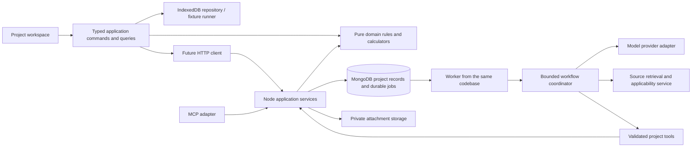

# System boundaries and repository direction

## Current implementation audit

Inspected October 26, 2026. No production deployment, external API, MongoDB session, or code-compliance behavior was verified during this architecture task.

| Current file / area | What exists | Treatment |
|---|---|---|
| `src/app.js`, `src/style.css` | Monolithic DOM workspace, local persistence, uploads, brief drawer | Keep preview during migration. Extract concepts and styles; replace mixed state/render/event handling with typed feature components |
| `src/intake.js` | Local regex intake and Markdown export | Retain as labeled demo adapter; never use as production interpretation or project authority |
| `src/technical.js` | Curated investigation topics and one adoption reference | Convert into a versioned playbook/reference seed, not an applied-requirements engine |
| `src/engine.js`, `server/src/engine.ts` | Duplicated fixed half-bath formulas, prices, tasks, and savings assumptions | Characterize existing behavior, then replace with one shared deterministic planning module. Current tests exercise the frontend engine only; the server comment claiming parity is not a parity test |
| `src/data.js` | Static inventory, task list, and unaudited code summaries | Keep as legacy demo fixtures. Revalidate technical sources and scope before any reuse |
| `server/src/models.ts` | Users/sessions and a flat half-bath project with default physical assumptions | Retain infrastructure as a starting point; introduce a versioned domain model with unknown defaults and migrations |
| `server/src/routes.ts` | Owner-scoped CRUD/auth and rule-based crew endpoint | Reuse HTTP scaffolding. Replace direct project patches with validated commands. Existing `doneTaskIds` updates do not enforce task prerequisites or evidence |
| `server/src/mcp.ts` | Read tools and canned crew output over authenticated MCP | Make a thin adapter over the same application services as HTTP; no separate planner or authority model |
| `src/api.js`, Firebase integration | Unused in current opening; future connectivity scaffolding | Keep isolated until server integration. Do not wire credentials into the browser or make auth a prerequisite for local workflow work |
| Existing tests | 15 passing deterministic/demo tests at the time of this plan | Useful baseline, not evidence of real model reliability, correct code interpretation, full workflow, or backend readiness |

Additional server hardening before exposing it: revoke server sessions on logout (currently only the cookie is cleared); validate IDs and enumerated inputs; handle Express async failures consistently; rate-limit authentication; verify account-linking semantics; and prove owner isolation through all routes, tools, jobs, exports, and attachment reads. These are later release requirements, not a reason to block local architecture work.

## Runtime design



This is a modular monolith. API and worker may run as separate processes for durable jobs, but share contracts and domain/application modules. No service mesh, independently deployed agents, vector database, or workflow vendor is required to begin.

### Authority boundary

The application command handler owns state transitions. The repository owns atomic persistence. The coordinator proposes changes and calls permitted tools. The model does not own the database, permissions, completion state, numerical totals, or interpretation of tool success.

In local development the same domain rules run against IndexedDB, with an explicit fixture execution mode. In connected mode the server validates and commits all authoritative changes; the browser may calculate previews against the same shared code. Do not silently merge two competing authorities.

## Target repository tree

The tree below is proposed, not currently present. Create only the modules needed by each delivery slice.

```text
apps/
  web/
    src/
      app/                    # shell, routes, dependency injection, mode selection
      features/
        properties/           # property/space explorer and source facts
        projects/             # lifecycle, goals, scope, next actions
        conversation/         # composer, attachment references, message views
        work/                 # artifact viewer registry and revision comparison
        activity/             # durable run progress, retries, waiting states
        decisions/            # review, approve, reject, and change requests
        execution/            # ready tasks, completion evidence, inspections
      components/             # shared visual primitives, not domain authority
      adapters/
        indexeddb/            # local repositories and schema migrations
        http/                 # command/query client and run event transport
        fixtures/             # explicit simulated runner and scenario loader
      styles/
      test/
  api/
    src/
      http/                   # HTTP auth, request validation, routing, streaming
      mcp/                    # adapter calling the same application services
      application/            # command handlers, queries, run orchestration
      agents/
        coordinator/          # persisted workflow steps and specialist dispatch
        specialists/          # typed responsibilities; no direct DB access
        tools/                # tool schemas, permissions, result validation
        providers/            # model adapter, structured output, usage accounting
      knowledge/              # retrieval, source revision, applicability, citations
      infrastructure/
        mongo/                # repositories, indexes, migrations, atomic commits
        blobs/                # private original/derived media and attachment reads
        jobs/                 # leases, retries, outbox delivery
      worker.ts
      server.ts
packages/
  contracts/
    src/                      # runtime schemas, IDs, command/event/tool DTOs
  core/
    src/
      domain/                 # facts, decisions, artifacts, plans, change impact
      planning/               # units, quantities, task DAG, releases, estimates
      playbooks/              # versioned project-type workflow definitions
      ports/                  # repository and clock/provider-independent interfaces
fixtures/
  projects/                   # sanitized end-to-end reference scenarios
  knowledge/                  # reviewed, permitted-use source fixtures
  runs/                       # bounded replayable tool outputs and failures
tests/
  domain/
  contracts/
  integration/
  browser/
  evaluations/
docs/
  architecture/
  design/
  history/
```

## Dependency rules

- `contracts` contains transport/persistence schemas and no UI, network, provider SDK, or database code.
- `core` can depend on contracts but not on React, Express, MongoDB, IndexedDB, or model SDKs.
- Both apps depend on core/contracts. Browser modules cannot import server infrastructure or secrets.
- Presentation consumes queries/view models and issues commands; components never patch canonical objects directly.
- Provider adapters translate into internal structured results. Changing a model must not require changing the domain model.
- Playbooks refer to capabilities and checks; do not embed side-effecting tool execution inside them.
- Enforce package boundaries with TypeScript project references and import checks once workspaces exist.

## Persistence and concurrency

Use IndexedDB transactions for the local aggregate and blobs. Use MongoDB for connected metadata and durable runs; keep large binaries in private object storage. Connected commits that update project revision, idempotency record, and outbox events must be atomic. This requires a supported transaction-capable database deployment or a deliberately embedded aggregate commit design; do not fake atomicity through sequential unrelated writes.

Runs use renewable leases. A process crash can resume from a stored checkpoint. The outbox publishes committed events after the transaction; consumers deduplicate event IDs. Polling is the first progress transport; resumable server-sent events can be added without changing run state.

Do not introduce collaborative offline synchronization in the first release. Local projects are independent workspaces. Import to an account is explicit, previewable, and creates a server project; attachments are uploaded only as part of that user-authorized import. Preserve the local original until the import is confirmed successful.

## Incremental migration

1. Keep `npm run dev` and the existing preview usable. Establish npm workspaces/build/test entrypoints before moving source.
2. Add contracts/core and fixture tests beside existing files. Route one typed project flow through the new command boundary.
3. Build the workspace shell in `apps/web`; migrate one feature at a time. Maintain an explicit legacy preview entry until browser scenarios pass.
4. Import current local project state into the new schema through a versioned adapter. Do not assume legacy strings are measurements or technical confirmations.
5. Move reusable server scaffolding into `apps/api` only when server integration begins; preserve existing routes temporarily behind adapters as needed.
6. Retire duplicated formulas and legacy entrypoints only after characterization/import checks pass. Keep historical fixtures labeled and isolated from production calculations.

Do not combine an all-at-once UI rewrite, database migration, model integration, and deployment into a single change.
