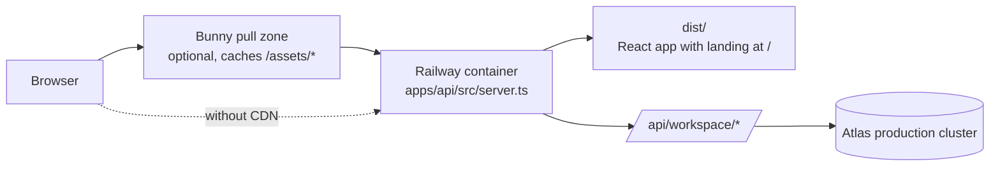

# Hosted deployment: one origin, one container

Status: deployable scaffolding implemented and tested locally (October 30, 2026).
Nothing has been deployed. Owner accounts, domain, production database and
provider credentials are not set up by code.

## Shape

The API server also serves the built site (`npm run build` → `dist/`), exactly
as development serves it, so the website, workspace and API share one origin.
The existing cookie, `Origin`, `Host` and `Sec-Fetch-Site` checks keep working
without CORS, and the web client's absolute `/api/workspace` paths need no
change. (`build:pages` is the older static package for GitHub Pages: it puts
the pre-v2 static `landing.html` at `/`, so it is not used for hosting.)

| Path               | Served as                                                | Cache                   |
| ------------------ | -------------------------------------------------------- | ----------------------- |
| `/`                | React app: landing v2, then the workspace; sign-in returns here | `no-cache` (revalidate) |
| `/assets/*`        | Hashed JS/CSS/images                                     | 1 year, `immutable`     |
| `/legacy.html`     | Earlier preview                                          | `no-cache`              |
| `/api/workspace/*` | Workspace API (unchanged rules)                          | `no-store`              |
| `/healthz`         | Liveness `{ok:true}`, no workspace data                  | `no-store`              |

The provider's redirect back to `/api/workspace/auth/<provider>/callback` is a
cross-site navigation, so that one GET is exempt from the `Sec-Fetch-Site`
check (its one-time `state` is the CSRF guard). Before this, a real browser
returning from Google or Meta would have been refused, locally too; the stubbed
tests did not send the header. They now do.

## Configuration (`apps/api/src/hosting.ts`)

With nothing set, the server is the same loopback development API as before.

- `RENOVAGENT_PUBLIC_URL`: the single public origin (https, no path). Adds it to
  trusted origins and hosts, marks session cookies `Secure`, and defaults the
  Google/Meta callbacks to `<origin>/api/workspace/auth/<provider>/callback`
  (explicit `GOOGLE_REDIRECT_URI` / `META_REDIRECT_URI` still win).
- `RENOVAGENT_HOST`, `PORT`: listen address. Listening beyond loopback without a
  public URL refuses to start.
- `RENOVAGENT_STATIC_DIR`: the built site to serve (`dist` in the image).
- A public origin without Google or Meta sign-in refuses to start: local
  single-owner mode hands its one workspace token to any visitor.

Names are listed in [`.env.example`](../../.env.example); values go only in the
host's secret settings.

## Files

- `Dockerfile`: Node 22, `npm ci`, `npm run build`, runs as `node`, health check.
- `railway.json`: Dockerfile builder, `/healthz` health check, restart on failure.
- `.github/workflows/ci.yml`: install, `npm run build` (typecheck, boundaries,
  builds), `npm test`, Docker image build. No deploy step, no secrets.

## Owner steps (cannot be done in code)

1. **Production database**: create a separate Atlas cluster/user for production;
   set `MONGODB_URI`. Allow Railway's egress (Atlas network access).
2. **Railway**: new service from the GitHub repo (it reads `railway.json`);
   generate the `*.up.railway.app` domain; set `RENOVAGENT_PUBLIC_URL` to it
   until there is a custom domain.
3. **Sign-in**: register the hosted callbacks with Google (OAuth client) and Meta
   (Facebook Login); set the four credentials as Railway variables.
4. **Domain** (later): add it to the Railway service, then change
   `RENOVAGENT_PUBLIC_URL` and the provider callbacks to it. Bunny in front is
   optional (it would cache only `/assets/*`; everything else is `no-cache` or
   `no-store`). Unverified: the server only accepts its public `Host`, while
   Railway routes by `Host`. Adding the domain to Railway and having Bunny
   forward it should satisfy both; test that before switching DNS.

## Not ready for the public (blockers)

- ~~Blob storage limit~~ (resolved October 30): attachments are now one
  document each in `workspace_blobs` (keyed by owner and blob id, raw bytes),
  not inside the owner's workspace document, so an owner's total is no longer
  capped at 16 MB. Bytes are checked against the batch's references and
  stored before the workspace commit; embedded attachments move out on first
  boot. See `apps/api/src/repository.ts` and `tests/integration/blob-store.test.ts`.
- **Provider review.** Google's production OAuth verification and Meta App
  Review need a privacy policy and terms on the domain; Meta also needs a
  data-deletion URL or callback. There is no account/data deletion yet.
- **Muse photo jobs and previews** spawn the `muse` CLI, which the image does
  not contain. Without it, those jobs fail with a stated error; planning works.
- **MCP over HTTP** (`apps/api/src/mcp-http.ts`) is a separate loopback process
  and is not in this container.
- **Single instance.** Photo/design workers run in-process; run one replica.
- **Landing claims** (competitor prices, sourced October 29, 2026) must be
  re-checked before launch; product images on the landing are labelled
  illustrations.

## App (mobile)

The workspace already runs in a phone browser. Two paths remain open:

- **Installable web app**: add a manifest and icons. Do not add a service
  worker that caches API or workspace state; it would fight revision/conflict
  rules.
- **Native iOS shell** (for in-app RoomPlan capture, LiDAR devices only; the
  import path already accepts `CapturedRoom` JSON): needs an Apple developer
  account, system-browser sign-in with a deep link (Google blocks OAuth in
  embedded webviews), and the app origin added to trusted origins.

## Verified

- `tests/integration/hosting.test.ts`: loopback default, public origin/host
  trust, secure cookies, hosted callbacks, refusal of unsafe settings, static
  serving and cache rules, API paths and writes never served as files.
- `tests/integration/accounts.test.ts` (connected, real Mongo): a public
  deployment serves the site, rejects a foreign origin, accepts its own, signs
  in to `/` with a `Secure` cookie through a cross-site provider return, and
  still refuses a cross-site data read; local mode on a public origin refuses
  to start. All sign-in scenarios fail without the provider-return exemption.
- Manual: `RENOVAGENT_STATIC_DIR=dist PORT=4107 npm run dev:api` served `/`
  (landing v2, checked by screenshot), hashed assets (immutable), `/healthz`,
  404s, and rejected a foreign `Host`.
- Not verified: a local Docker build (no Docker on this machine; see CI), a
  Railway deploy, Bunny, real provider sign-in on a hosted URL.
