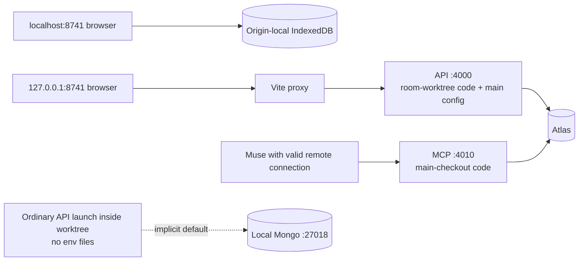
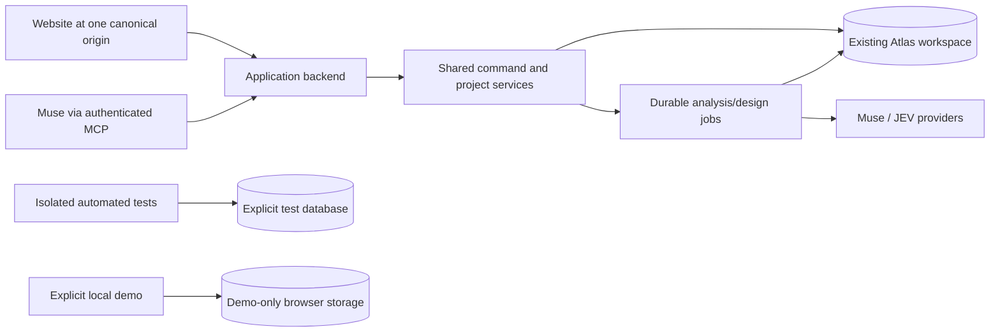

# Runtime, storage and Muse integration — technical review

**Reviewed:** October 30, 2026 · **Scope:** current local application, Atlas selection, browser storage, launch configuration and Muse paths. **Disposition:** diagnosis and recommendations; no runtime configuration, project data, credentials or deployment was changed.

## Recommendation

**Use the existing Atlas workspace as the default authority for the actual product. Keep local Mongo for explicitly isolated tests or development experiments. Make the browser-only demo an explicit mode.**

Running the website on localhost is useful during development: it runs our changing code while the API holds database/provider credentials and talks to Atlas. Moving data to Atlas does not host the website, run its API, or expose a Muse connector. These are separate responsibilities.

The present confusion comes from retaining three independent storage paths, two browser hostnames, multiple environment-file rules and independently launched services from different checkouts. Those are prototype/migration leftovers, not requirements of an Atlas-backed product. A focused consolidation is preferable to a new framework, database or microservice rewrite.

## 1. What is actually running

| Component | Observed state | Meaning |
| --- | --- | --- |
| Frontend | Vite, port 8741, room worktree | Local development UI; source updates appear through Vite |
| Workspace API | Port 4000; room-worktree source launched through `.local/with-main-env.ts` | Uses main-checkout configuration and working directory |
| Muse MCP HTTP | Port 4010; main-checkout source via a temporary diagnostic wrapper | Separate process, release and startup path from the UI/API |
| Atlas | Resolver selects `RENOVAGENT_MONGO_URI`, database `renovagent_workspace` | Connected shared workspace; eight projects in the inspected owner aggregate |
| Browser-local workspace | IndexedDB selected unless an origin's saved mode equals `mongo` | Separate records, not a synchronized Atlas cache |
| Local Mongo | No listener found on historical ports 27017 or 27018 | No current evidence that either local database is required by the running API |

Root and room-worktree HEADs were `e892174` and `1e3ce99`; both also contain uncommitted work. A commit hash alone therefore does not identify the running release. The API was started at 19:25 on October 30, while Vite/MCP were started around 08:43. Source files changing on disk does not refresh an ordinary long-running API/MCP process.



The browser selections in this diagram are the observed state of the two existing origins, not a hardcoded hostname rule. Either hostname can be connected or local; each remembers independently.

## 2. Findings

### F1 — High: the actual product defaults to an independent browser database

`WorkspaceController.open()` uses HTTP/Mongo only when `storedMode() === 'mongo'`. Otherwise it opens IndexedDB. The preference itself is in localStorage. Consequently `localhost:8741`, `127.0.0.1:8741`, another port, and another browser profile can all show different workspaces while serving identical application code.

The current localhost tab showed the browser-local project; the IP-address origin opened the shared Muse QA project during the preceding UI audit. This explains apparent missing work without another Mongo URI being involved.

`connectBackend()` imports a browser snapshot only if the destination workspace is empty. If Atlas already contains projects, it opens Atlas and preserves the browser original. That is protective behavior, but it is **not a merge or ongoing synchronization**. The current interface does little to explain the change of records.

**Fix:** default the product to the connected API. Expose an explicit “Try a local demo” mode, with a clear storage label. Choose one canonical development URL. Before redirecting existing alternate origins or removing local mode, inventory/export their records and offer a reviewed per-project import with ID/conflict handling. Do not clear browser storage or replay the original cluster migration.

**Evidence:** [controller](../../apps/web/src/app/workspace-controller.ts), storage-mode helpers and `open`/`connectBackend`; [previous browser audit](../design/style-and-pipeline-audit-2026-10-30.md).

### F2 — High: launching the active worktree normally selects local Mongo

The main checkout has configured database values; the room worktree has neither `.env` nor `server/.env`. Calling the resolver normally from that worktree reproduced:

```text
main checkout:       cluster / RENOVAGENT_MONGO_URI / renovagent_workspace
room worktree:       local   / default-local         / renovagent_workspace
active API wrapper: cluster / RENOVAGENT_MONGO_URI / renovagent_workspace
```

This fallback happens even though a cluster is configured in a different checkout. The resolver searches relative to the process's working directory; it does not discover the main checkout. The active API reaches Atlas because a custom ignored wrapper injects main-checkout settings and changes its working directory. A routine restart with the documented command can therefore behave differently.

The resolver does not fall back after a selected cluster connection fails. The dangerous ambiguity is **missing configuration choosing local implicitly**, including when target is `configured` but no URI exists.

**Fix:** require a configured URI for ordinary connected mode and fail with an actionable configuration error when absent. Permit local Mongo only through an explicit development/test command. Use a maintained launcher with an explicit configuration path and separate runtime-data directory; do not hardcode the owner's absolute path in application code. All API/MCP/worker/catalog entrypoints must receive the same resolved configuration.

**Evidence:** [database resolver](../../apps/api/src/database-config.ts), lines 10–49; [connected launcher](../../scripts/dev-connected.ts); active `.local/with-main-env.ts`.

### F3 — Medium: duplicate configuration and incompatible local conventions remain

Current inspection found `RENOVAGENT_MONGO_URI` in both main `.env` and `server/.env`. **Their values currently match.** This review found no conflicting cluster selection between those two values. However, having both permits future divergence.

The resolver overlays `server/.env` after `.env`, then applies different environment precedence rules by variable name: `RENOVAGENT_*` environment values win over files; generic names prefer files. It accepts three URI aliases. Some older documentation still says process environment always wins and names `MONGODB_URI` as the selected variable. That description is stale for the current configuration.

The retained `MONGODB_URI_LOCAL` points at `27017/unpermitted`, while `scripts/local-mongo.ts` starts `27018/renovagent_workspace`. In explicit local mode the combined launcher can start 27018 while waiting for the separately configured 27017 service. The persistent local helper uses a real `mongod` with a saved dbPath, despite the package name `MongoMemoryServer`; it is not inherently an ephemeral database.

**Fix:** standardize on `RENOVAGENT_MONGO_URI` for connected runtime, consolidate local secrets into one explicitly loaded file, and use host environment variables when deployed. Retire aliases with a clear transitional error rather than silent precedence. Keep test database configuration independent. Preserve historical local data/backups until reconciled; stopping its use does not require deleting it.

**Evidence:** [resolver](../../apps/api/src/database-config.ts), [local helper](../../scripts/local-mongo.ts), [launcher](../../scripts/dev-connected.ts), [redacted evidence](../evidence/runtime-topology-2026-10-30.json).

### F4 — High: healthy listeners conceal a severely slow workspace read path

Two read-only probe runs produced:

| Probe | Run 1 | Run 2 |
| --- | ---: | ---: |
| New Atlas client connection | 496 ms | 6,681 ms |
| Atlas ping | 33 ms | 43 ms |
| Aggregate metadata projection | 42 ms | 41 ms |
| API liveness | 20 ms | 33 ms |
| API session | **35,222 ms** | **32,675 ms** |
| MCP liveness | 6 ms | 4 ms |

The owner aggregate measured **3,058,258 BSON bytes**, eight projects, 71 messages and two jobs. A direct full-document fetch in the second run exceeded a **15,000 ms client operation budget**. Local schema/integrity validation was not reached by that probe, so its cost is unmeasured. These results implicate the expensive full-document path; they do not establish the exact contribution of transfer, contention or connection behavior, and do not justify blaming Atlas availability or schema validation alone.

The code amplifies that path:

- `/session` reads and validates the entire aggregate merely to report session/capability state. Opening HTTP storage then reads the workspace again.
- Every repository `read()` fetches the owner aggregate and validates its complete workspace. `/photo-jobs` reads that aggregate just to return job status.
- The API ticks workers every three seconds. An idle photo tick can read the aggregate twice, and its `running` guard is set only after those initial awaits; slow reads can overlap ticks. The design worker also reads workspace state to discover pending work.
- The connected photo component starts a 2.5-second interval, without waiting for the prior request to finish. Hiding its native `<details>` does not unmount the component or stop its effect while its parent remains mounted.
- Writes use whole-owner compare-and-swap replacement and enforce a 14 MiB aggregate limit. Moving image blobs to a separate collection helped, but project history still shares this growing document.

**Fix first:** instrument query, transfer, validation and serialization durations; bound client/server requests; guard workers before their first await; use completion-driven/backoff polling. Make session checks lightweight, and query projected job/status data without fetching all projects/history. Preserve command validation and revision checks on writes. Then introduce version-aware read caching/projections and archive or separate growing history in a reviewable migration. Do not remove integrity validation as an unmeasured shortcut.

Add readiness distinct from liveness: the existing `/healthz` correctly answers whether the process is alive; it cannot prove useful workspace access. A proposed demo gate is warm session/status p95 under one second and first usable workspace p95 under three seconds over a small repeatable sample. These are targets, not achieved measurements.

**Evidence:** [API server](../../apps/api/src/server.ts), session handler and worker interval; [repository](../../apps/api/src/repository.ts), `read`/`update`; [photo worker](../../apps/api/src/photo-jobs.ts), `tick`; [design worker](../../apps/api/src/design-previews.ts); [HTTP client](../../apps/web/src/adapters/http/project-repository.ts); redacted probe results.

### F5 — High: the Muse connector is a separate, drifting runtime

The current 4010 wrapper imports the main checkout and does not supply `DesignImageStore`; the maintained MCP launcher does supply it. Current design-tool handlers require that store. Therefore the wrapper is not equivalent to the maintained design-capable entrypoint, even before accounting for its already-loaded older code.

`npm run dev:connected` starts the API and Vite, **not MCP HTTP**. Meanwhile Vite's `/mcp` proxy points to 4000, although MCP listens at 4010 and the API has no MCP handler. Calling that path will not reach the current connector. A temporary tunnel/credential test from October 29 proves past consumer-Muse interoperability, not a current stable connection. No grant was issued or renewed in this review.

**Fix:** one maintained launch command should start all required processes from the selected checkout/configuration and report their build/source and capabilities. Route `/mcp` to the actual maintained MCP service, or mount the transport deliberately in the backend. Both approaches can reuse the existing domain/repository; a second application stack is unnecessary. Verify tool discovery, a read, and a bounded proposal from the actual consumer Muse client against the same project visible on the website.

**Evidence:** [MCP HTTP launcher](../../apps/api/src/mcp-http.ts), [MCP handlers](../../apps/api/src/mcp.ts), [Vite config](../../vite.config.js), [connected launcher](../../scripts/dev-connected.ts), `/tmp/renovagent-mcp-observed.ts` inspected without publishing its former endpoint.

### F6 — High: Atlas does not complete the user-to-agent workflow

Website submission creates records; the message composer appends notes. There is no general conversational coordinator triggered by normal “get started.” Muse CLI photo analysis, JEV classification, design-option generation and MCP calls remain separate entrypoints.

Uploaded intake originals live in workspace attachment storage. Design previews use a separate design-image store/API; ordinary setup does not bridge the selected original into it. The newer JEV photo-pin results live in React component state and disappear on remount, whereas the older Muse photo-job path has durable jobs. Saving inspiration URLs/images does not identify their products or fetch retailer pages/prices.

**Fix:** connect one bounded supported workflow through existing commands: room + inspiration + brief → durable analysis → scope/design choices → materials and explicit labor basis → contractor handoff. Persist analysis against original evidence hashes and expose the same job status/results to the website and Muse. Keep references separate from observed site conditions. Shared storage enables this orchestration; it does not perform it.

**Evidence:** [controller](../../apps/web/src/app/workspace-controller.ts), `createProject`/`sendMessage`; active room worktree `features/room3d/owner-photos.tsx`; [reference increment](inspiration-and-products.md); [design flow](design-options.md).

### F7 — Medium: connected upload limits disagree with the frontend

Intake accepts five photos up to 20 MiB each. The connected command API permits at most 12 MiB of **base64 text per blob**, roughly 9 MiB of original bytes, and 20 MiB for the entire JSON request. Encoding expands the bytes. A photo or multi-photo batch accepted locally can fail only when saved through the connected API. Design-image normalization has yet another input allowance.

**Fix:** define shared original/per-upload/batch limits and enforce them before submission. Prefer bounded binary or staged uploads with attachment hashes, then one validated metadata/command commit; keep original/derivative semantics clear. Until that exists, align the smaller connected limits in the UI and show a useful error without discarding the draft.

**Evidence:** active `apps/web/src/app/project-intake.ts`; [API blob/body schemas](../../apps/api/src/server.ts); [blob encoder](../../apps/web/src/adapters/http/project-repository.ts); [design images](../../apps/api/src/design-images.ts).

### F8 — High before hosting: the container does not contain the whole demonstrated product

The existing container serves the frontend and API, but does not start MCP HTTP or include the Muse CLI. Image normalization invokes macOS `sips`; the container is Linux. Deploying it unchanged would not reproduce the local photo/design workflow. The older `build:pages` packaging also replaces the homepage with the previous static landing, so it is not the current connected deployment artifact.

**Fix:** extend the existing hosting scaffold rather than adding another unrelated frontend. Supply a supported image converter and provider runtime/worker, a reachable authenticated MCP transport, and the existing public account mode. A worker may be separate from the web listener, but must use the same release and Atlas authority. Test in the actual container before claiming hosted parity. Local-only single-owner access must remain local; the existing public-auth guard should be preserved.

**Evidence:** [Dockerfile](../../Dockerfile), [hosting plan](hosted-deployment.md), [design normalization](../../apps/api/src/design-images.ts), [Muse process adapter](../../scripts/muse-provider.ts), [Pages packager](../../scripts/package-pages.mjs).

## 3. Recommended operating model



This is a proposed consolidation, not an implemented topology. The MCP listener and job worker can remain separate processes initially. What matters is one source/configuration, one durable project authority, and a coherent workflow.

| Keep | Change | Retire from normal product use |
| --- | --- | --- |
| Atlas and existing project IDs/history | Connected storage as default | Implicit fallback to local Mongo |
| Pure domain commands, contracts and revision rules | One maintained runtime/config loader | Temporary and owner-path launch wrappers |
| Separate original images and derived model media | One photo-to-job bridge | Independent unlabelled browser workspaces |
| Local Vite during active development | One canonical development URL | Alternating 8741/8742 or localhost/IP as interchangeable bookmarks |
| Isolated Mongo integration tests | Source/build, storage and provider status distinguishable | “Provider configured” presented as “Muse connected” |

Atlas should remain the shared application database now. Local Mongo's useful role is disposable/isolated integration testing or an intentional offline experiment. Existing local data is historical material to preserve and reconcile, not a live replica to synchronize automatically.

## 4. Implementation order and acceptance

### A. Make startup and record ownership predictable

1. One explicit config contract and launcher for the selected checkout; ordinary connected startup refuses missing Atlas configuration.
2. Connected product by default; explicit local demo. Show a concise shared/local indicator and selected project.
3. Inventory/export alternate-origin and legacy local records before redirecting/removing paths. Import selected projects with conflict checks; never overwrite Atlas wholesale.
4. Start maintained API/MCP/worker services with source/build identifiers and safe database target labels. Remove temporary wrappers from the operational path.

**Gate:** a fresh browser opens the intended shared records; website and MCP read the same project/revision; restarting from either supported checkout cannot silently create/select a local database. Existing eight-project baseline and unrelated owner work remain intact.

### B. Make the shared workspace responsive

1. Add timing boundaries and readiness; profile the observed full-document fetch.
2. Lightweight session/job reads; bounded non-overlapping worker and UI polling.
3. Align upload limits and validate a realistic multi-photo batch against the actual API.

**Gate:** repeatable latency targets above are met, no overlapping idle polls accumulate, and an allowed upload batch succeeds through connected storage and reload. Failed uploads preserve the user's input.

### C. Deliver one actual promise end to end

Bridge existing room/reference inputs to saved analysis and one supported recipe/design flow, then quantities, sourced product leads, labor basis and handoff. Test both the website and standard consumer Muse. Configured keys or fixture-only tests do not satisfy this gate.

**Gate:** a separate non-example QA project yields useful saved work from a photo/brief; a user's revision updates its affected results; reload and Muse reads show the same artifacts. Inspiration matching is credited only after it actually produces linked candidates.

### D. Host the consolidated release

Use the existing container scaffold after provider/converter/MCP parity is established. Serve one permanent HTTPS origin backed by Atlas and existing account controls. A permanent URL removes dependence on this Mac and an expiring tunnel; it does not replace the workflow work above.

**Gate:** container smoke test, authenticated consumer-Muse read/proposal, website parity and bounded worker restart/recovery pass on the actual hosted runtime.

## 5. Evidence and limits

- New checks: two database-configuration tests passed. They confirm present behavior, including the fallback we recommend changing; they do not certify the desired architecture.
- Direct probes used `MongoClient` reads/projections only, not the repository connector that can initialize/migrate state. No model request, import, mutation, credential/grant change, service restart or deployment was performed.
- Metadata/timings are preserved in [runtime-topology-2026-10-30.json](../evidence/runtime-topology-2026-10-30.json). Credentials, cluster hostnames and project contents are excluded.
- The preceding [style/pipeline audit](../design/style-and-pipeline-audit-2026-10-30.md) records browser observations and 45 passing scoped tests. Those results are historical evidence for this review, not a new full-suite run.
- Exact slow-read root cause, current authenticated consumer-Muse tool inventory, container parity and hosted behavior remain unverified. They are explicit acceptance work, not assumed capabilities.
