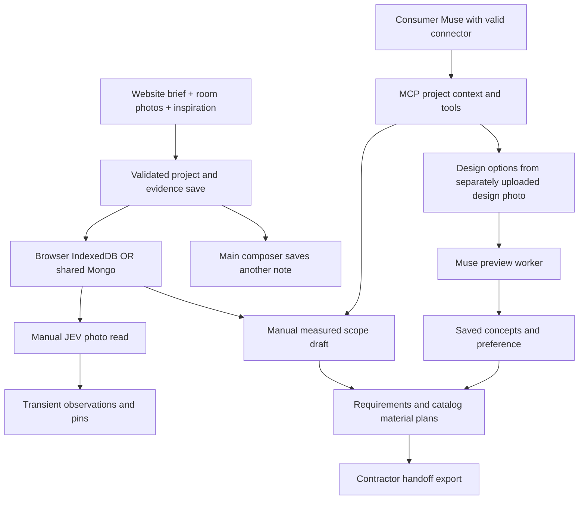

# Start experience and Muse pipeline audit

October 30, 2026. Review of the live 8741 checkout at `.claude/worktrees/room-3d`, browser inspection at desktop and 390 × 844, source tracing, and 45 passing targeted tests. This is an audit; product behavior was not changed.

## Verdict

The visual landing promise is stronger than the first-use experience. There are useful working components: persistent intake, photo/reference originals, deterministic scope/material calculations, an interactive example room, and a substantial contractor handoff. Creating an ordinary project does not yet orchestrate those components into a first useful result. The most valuable next increment is that connection.

## What a visitor actually gets

| Promise | Current evidence | Gap |
| --- | --- | --- |
| Start from a brief, photos and links | Intake and reference persistence tests pass; existing browser flow was reviewed | Creation saves inputs; it does not analyze or draft automatically |
| Identify what is in the room | JEV server/client implements bounded room/floor/fixture classification and boxes; tests pass | Explicit button; result is component state and disappears on remount/refresh. Inspiration discovery is separate and absent |
| See the room, work and costs | Example room opens, finish picker changes the render, step popup shows material/tool allowances and shopping searches | Example renders and contractor quotes are fixtures. An arbitrary uploaded room does not acquire that experience automatically |
| Compare visual designs | Backend, MCP tools, preview worker and option viewer exist; previous real Muse evidence is recorded | Hero/intake uploads are workspace blobs; design upload is a separate API/store. No normal setup action bridges these and starts options |
| Complete material requirements | Versioned bathroom/living-room recipes and measured quantity math work | Coverage is bounded; a complete source-backed retail/labor estimate for arbitrary projects is absent |
| Products and prices | Saved product URLs, notes/prices, catalog recall and sourced landing sample links exist | No automatic Pinterest extraction, exact-product recognition, similar-product search or live price refresh |
| Contractor handoff | Browser opens a generated Markdown scope with quantities, sources and reply fields; tests pass | Quote examples are fictional. Live contractor quote collection/comparison and general crew-hour estimation are absent |
| Works with Muse | Actual consumer Muse read/write proof exists from October 29; current API reports Muse and JEV configured | That proof used an expiring connection. The current connection modal has no pairing action; today's consumer connection was not re-established |

## Style findings

1. **Setup is form-led.** Six room boxes precede the useful brief/photo input. Location consumes a second desktop column and another phone screen. On the normal 1280 × 720 viewport the footer action needs scrolling; at 390 × 844 the initial screen reaches only the start of location. Reduce room choices to compact chips, lead with photos/brief, collapse optional location/budget, and keep one clear action reachable.
2. **The first project screen has little momentum.** A large empty photo panel, another starting-point explanation, measurements, an empty reference board and then “What else would you like to improve?” repeat the setup rather than producing work. Show the uploaded image and a focused next action that creates an initial draft.
3. **Room and inspiration need separate attachment lanes.** Setup applies one My room/Inspiration switch to the entire photo batch. People need their room and their target look together. Keep those roles separate and visible on the initial screen.
4. **The room viewer has the strongest utility but inconsistent controls.** Finish/view switches are small, square and browser-like; the step popup is more developed. Use the same typography, spacing and control treatment as intake/landing. Prefer a compact work summary over raw Markdown in the handoff popup; retain the complete document as an export.
5. **Navigation creates a dead end.** “Renovagent home” only closes panels; it does not return to the landing. Once a project exists there is no clear marketing-home route. The tool menu exposes many similarly weighted destinations and old simulation surfaces.
6. **Muse is represented by explanatory text.** The connection screen says what should happen and links to house/photo tools. It needs a real connection state and a clear handoff for the selected project.

Evidence: [desktop setup](../previews/style-audit-start-desktop.png), [phone setup](../previews/style-audit-start-mobile.png), [current Muse screen](../previews/style-audit-muse-connection.png), [working room](../previews/style-audit-room-working.png).

## Pipeline today

There is no edge from submitting the website brief to a live planning agent. `sendMessage` issues only `AppendMessage`. JEV is a bounded perception/ranking service, not the conversational coordinator. The existing durable Muse photo jobs are a different path from the newer transient JEV pins.

## Runtime findings

- The original `localhost:8741` tab displayed the browser-local `mansion` project. Its Muse dialog explicitly offers connection through house tools. `127.0.0.1:8741` displayed the Mongo-backed Muse QA project and a connected photo-analysis message. Each origin retains a separate storage-mode preference. This is a visibility/connection problem, not evidence of another incorrect Mongo URI. No data was migrated or changed during this review.
- API `/healthz` and MCP `/health` returned 200. A session probe first exceeded 12 seconds; a later probe completed in **39,898 ms**, reporting `mongo: true`, `muse: true`, `jev: true`. Health success does not establish responsive workspace access. The browser eventually opened the connected records. Root cause was not established.
- The 4010 diagnostic wrapper imports the root checkout, while 8741 serves the room worktree. It is a long-running process from the earlier connector test. Current source declares 16 MCP tools in the room worktree, including review/handoff. Do not equate that source inventory with the tools currently discovered by consumer Muse. Refresh the intended runtime and verify discovery before the demo; no credentials, grants or tunnels were changed here.

## Next increment and acceptance gate

Connect one real path: **room + inspiration + brief → saved analysis → first scope/design choices → product leads and supporting materials → separate labor → handoff**. Keep the first draft useful without requiring every measurement. Ask only the next question needed for the affected quantities.

Do this before another broad visual redesign:

1. Make shared/local mode and selected project explicit; keep existing records safe. Diagnose slow connected reads and align API/MCP source/runtime.
2. Add a first-draft action using the existing command/recipe services; persist JEV observations with source identity; bridge room originals into design previews when requested. Refresh must preserve the result. The initial slice can stay within the supported bathroom/living-room recipes.
3. Simplify setup and the project screen around that action. Add reference analysis/product matching as a distinct subsequent stage, with actual source links and dated prices.

Prove it using a new isolated non-example project, the standard Muse client, one owned room image and one inspiration reference: saved result survives reload, user-selected revision reaches materials/handoff, and changing a measurement updates affected quantities. That gate has not passed in this audit.

## Verification limits

45 targeted tests passed: intake, references, scope drafts, design-option domain behavior, photo interpretation, reviews, product ranking, JEV adapter behavior, example photo behavior and contractor handoff. Provider tests use controlled inputs; this is not a fresh live-model or live-retail verification. Browser demo work used a separate localhost:8757 IndexedDB origin. Existing project contents and runtime configuration were preserved. The temporary preview was stopped after inspection.
